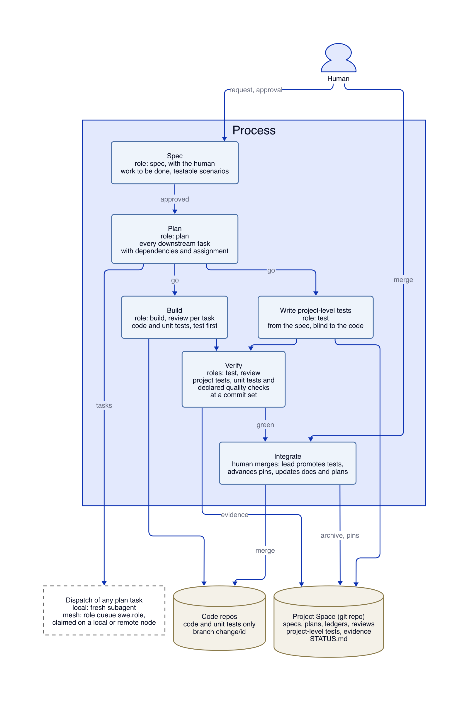

# SWE Pod — specification

- Spec id: `swe-pod`. Requirements are cited as `swe-pod/R4`, scenarios as
  `swe-pod/R4.S1`.
- size: project
- owner: agallojr
- repos: [swe-pod, agent-mesh]
- supersedes: []
- Status: revision 3, 2026-10-27 (UTC), approved.
- approved: agallojr 2026-10-27T21:36Z
- Replaces two earlier drafts kept in the operator's private library: a design
  concept (revision 2, 2026-10-26) and an engineering process (draft 1,
  2026-10-27). Both used OpenSpec and superpowers as plug-ins. This revision drops both tools and keeps what we
  learned from them. Rules taken from them are marked (OS) or (SP).
- Build output: Markdown (§13). The SWE Pod is a process carried by documents,
  role briefs, templates and a skill that agents read. Nothing in it is
  compiled.
- Relies on: the memory-spaces concept (Agent Mesh design, revision 2,
  2026-10-27), restated in this space as `notes/note-20261027T2142Z-0a31-memory-spaces-design.md`, for the Project Space as a git repo mounted in the bus as a
  submodule and loaded on request, with a shareable header profile, one
  librarian and collision-free ids. Nothing else from it is required.
- Diagram: `spec-process.png` (D2 source alongside)

## 1. Operator decisions (2026-10-27)

1. Specs come first and are the basis of all work. A spec covers the work to
   be done, not a retrospective spec of the whole system.
2. Specs, process documents and records live in the project's memory space,
   which is a git repo. Code repos hold code and unit tests. Project-level
   tests live in the project memory space.
3. Pod roles are held by mesh agents, local or remote. Roles are independent:
   a test agent writes neither code nor specs. Test agents will often sit on a
   remote machine, since tests are heavy.
4. The process is spec, plan, build, verify, integrate. The plan covers all
   downstream work and its dependencies. Verify tests against the spec and
   runs the quality checks the spec declares (decision 9). Integrate updates
   docs, plans and pins.
5. Any task in the plan can go to a local agent or, through the mesh, to a
   remote one.
6. Every memory space has a librarian, its only mesh writer. One librarian may
   manage several spaces, so the mesh's librarian can manage a project's space
   as well as core and lore.
7. Project Spaces never branch. Each code repo a spec names gets one branch
   for that spec, shared by every agent working it.
8. The SWE Pod works without an Agent Mesh: no bus, no core or lore, no remote
   agents. It may still depend on the Agent Mesh product's code, for instance
   to run its librarian on the Project Space.
9. No test or quality tooling is fixed for now. Testing is part of the
   lifecycle; quality checks grow over time, module by module, each declared by
   a spec ("tool XYZ shall be used and its review passed").
10. The SWE Pod is its own product, with its own product repo beside the Agent
    Mesh product. Its own development is a project with its own private Project
    Space.

## 2. Terms

| Term | Meaning |
|---|---|
| **Project** | One Project Space plus the code repos it names. |
| **Project Space** | The project's memory space: a git repo holding specs, plans, records and project-level tests. Mounted in the bus as a submodule under `spaces/`; loaded into a session when asked for, or by a task that names it. |
| **Code repo** | A repo of the project's deliverables: code, its unit tests and the docs that ship with it. A project whose deliverable is not code (documents, a paper) has a deliverable repo in the same place, under the same rules. |
| **Change** | One unit of intended work, with one intent that fits in one sentence. The unit of spec, plan, verify and handoff. |
| **Spec** | `changes/<id>/spec.md`: why, scope, and requirements with testable scenarios for one change. |
| **Plan** | `changes/<id>/plan.md`: every downstream task of a change, with roles, dependencies and assignments. |
| **Task** | One plan entry, done by one agent in one role, with a brief, a result and a done-when. |
| **Commit set** | One commit per affected code repo plus the Project Space commit. What verify runs against. |
| **Code branch** | `change/<id>` in a code repo: one per spec in each code repo the spec names, shared by every agent of that change. The Project Space has no branches. |
| **Pod role** | spec, plan, lead, build, test, review (§6). On the mesh, the role `swe.<role>`. |
| **Lead** | The pod role that dispatches tasks, keeps the ledger, makes rulings and writes the change's records. |
| **Librarian** | A memory space's only writer, which checks each record's header profile, references and id before filing it. On a mesh, a role one node holds; without a mesh, the session runs it from the Agent Mesh product. One librarian may manage several spaces. |
| **Quality check** | A requirement in a spec's Quality section naming a tool, how it is run, and what passing means. |
| **Evidence** | A record of one verify run: commit set, environment class, a result for each scenario, quality check and unit suite. |
| **Environment class** | A machine kind (`macos-laptop`, `linux-server`, `hpc-login`), never a hostname. |

## 3. Scope

In:

- The process, its stages, gates and records.
- Pod roles, their independence, and where they run.
- The Project Space layout and record formats.
- Dispatch of any task to a local agent or through the mesh.
- Use without an Agent Mesh: one session and its local subagents.
- The Markdown deliverables that carry all of the above (§13).

Out:

- Retrospective specs of existing code. A project starts with its first
  change.
- Project management: boards, estimates, burndown. Status is rendered from
  records and only read (§11).
- Fixed test or quality tooling, and CI. Verify runs the project-level tests,
  each repo's unit tests and the quality checks each spec declares. Tooling
  is added module by module over time.
- Mesh core changes beyond those listed in §14.

## 4. Shape of a project

| Thing | Lives in |
|---|---|
| Specs, plans, ledgers, briefs, reports, reviews, evidence, decisions, handoffs, `STATUS.md` | Project Space |
| Project-level tests (acceptance tests for each spec, cross-repo tests, the regression suite of integrated specs) | Project Space |
| Code, unit tests, docs that ship with the code (README, API docs) | Code repo, on branch `change/<id>` until merged |
| Mesh task messages, workflow records, agent and task ids | Mesh bus, never the Project Space |

`pod.yaml` at the root of the space names the code repos and their pins:

```yaml
pod: 1
project: fvm-vqls
process: swe-pod-process@1         # pinned PROCESS.md version
repos:
  qutil: {remote: "<url>", pin: "<sha>"}
  fvm:   {remote: "<url>", pin: "<sha>"}
depends: {fvm: [qutil]}            # merge order: qutil before fvm
gates: {spec: human, plan: human-skim, merge: human}
```

**Branches.** A branch in this spec always means a git branch in a code repo.
For a spec `add-vqls-backend` that names code repos `qutil` and `fvm`, each of
those two repos gets one branch, `change/add-vqls-backend`, and the Project
Space stays on `main`.

- The Project Space has one branch, `main`, and never another. Work in flight
  is kept apart by folder (`changes/<id>/`), not by branch, which is why a
  change's project-level tests wait in its folder until integrate.
- Each code repo a spec names gets exactly one code branch for that spec,
  `change/<id>`. The lead creates it at the go, from the repo's pin in
  `pod.yaml`, and records the base commit. Every agent working the change
  commits to it. Repos the spec does not name get no branch.
- No other branch is pushed: no task, agent or personal branches. An agent may
  work in its own clone or worktree, but its commits reach the remote only on
  `change/<id>`.
- An amendment to the spec stays on the same branch. A new spec gets a new
  branch.
- If another change integrates first and moves `main` under a change branch,
  a build task rebases the branch onto the new `main`, and verify runs again
  (R15).
- The branch is deleted after its merge, as part of the human's merge.



## 5. The process

| Stage | Role | Reads | Writes | Done when | Gate |
|---|---|---|---|---|---|
| **spec** | spec, with the human | the request, the code, earlier specs it touches | `spec.md` | every requirement has a scenario; the human approved | human approves |
| **plan** | plan | the approved spec, the code | `plan.md` | every requirement traces to a build task and every scenario to a test; self-review passes | human skims (project size) |
| **build** | build; review per task | its brief | code and unit tests on `change/<id>` | each task passes its done-when and its review | none |
| **verify** | test; review | spec, project-level tests, the commit set | evidence, whole-change review | every project-level test, unit suite and declared quality check passes at the commit set; no open Critical or Important finding | none |
| **integrate** | human, lead | everything above | merges, pins, docs, plans, final report, archive | merged in dependency order; tests promoted; report filed | human merges |

Writing the project-level tests is a test task that starts at the go, in
parallel with build, from the spec alone. Builders add to them only by
suggesting tests, which the test agent takes up or declines (§5.4). A change's
state is read from its records, never set by hand:

| State | Read from |
|---|---|
| proposed | `spec.md` exists without `approved:` |
| approved | `spec.md` has `approved:` |
| planned | `plan.md` exists with its self-review filled in |
| building | the ledger has a dispatch |
| verified | the latest evidence is green at the current commit set and the whole-change review has no open Critical or Important finding |
| integrated | `spec.md` has `integrated:`; the folder is under `changes/archive/` |
| abandoned | `spec.md` has `abandoned:` with a reason |

### 5.1 Spec

The spec author works with the human. It describes the work to be done and
nothing else (R2).

**Drawing out intent** (SP):

- Look before asking. Read the code and any earlier spec the request touches
  until you can say how things work today. Never ask what the project already
  answers.
- Play the request back in your own words, with anything found that bears on
  it: a constraint, a conflict, a cheaper path.
- Ask one question per message, the one whose answer most changes what gets
  built.
- Before writing up, give the two or three real ways to do it, what each
  trades off, and a recommendation. The human picks.
- Any default the author fills in is listed under Open calls, never presented
  as agreed. "Just draft it" means draft now, with defaults listed.

**`changes/<id>/spec.md`.** The id is verb-led kebab-case, such as
`add-vqls-backend`.

```markdown
# add-vqls-backend: let the nozzle solver use VQLS as its linear solver

- size: project
- owner: agallojr
- repos: [qutil, fvm]
- supersedes: []                 # earlier requirement ids this work changes
- approved: agallojr 2026-11-01T15:20Z

## Why
## Scope
In: ...
Out: ...
## Requirements
### R1 VQLS linear solver option
The solver SHALL accept VQLS as its linear-solver backend.

#### R1.S1 Converges on the subsonic reference case
- GIVEN the quasi-1D nozzle reference case at nelem 5
- WHEN it is solved with the VQLS backend for 20 iterations
- THEN the L2 density error against the exact isentropic solution is below
  1e-3 (dimensionless, normalized by inlet density)

#### R1.S2 Rejects an unknown ansatz name
- GIVEN an ansatz name the backend does not define
- WHEN the solver starts
- THEN it exits non-zero before building any circuit and names the bad value
## Quality
### Q1 Linter clean
The changed code SHALL pass the repo's linter with the repo's configuration.
- check: the linter's command in each affected repo; passing is exit status 0
## Approaches
The two or three considered, the one picked, and why.
## Open calls
Defaults the author chose; the human checks these.
```

(Values illustrative.)

**Rules for requirements and scenarios** (OS):

- One behavior per requirement, with one SHALL or MUST.
- Observable: someone who has never seen the code can tell whether it holds.
- No internals: no class names, library choices or steps.
- At least one scenario per requirement, exercising it, not restating it.
- Cover error and edge cases, not only the happy path.
- Every number carries its unit and tolerance, and any convention it depends
  on: norm, normalization, reference solution.
- Ids are local to the spec (`R1`, `R1.S1`) and qualified outside it
  (`add-vqls-backend/R1.S1`). When later work changes behavior an integrated
  spec requires, its spec lists those ids under `supersedes`, and its test
  tasks update the old tests.
- A fix that restores behavior an integrated spec already requires may cite
  that requirement in place of new ones: a five-line spec.
- **Quality checks** go in the Quality section, one per tool or review: what
  is run, on what, and what passing means. They are requirements like any
  other, so verify runs them and evidence records them. A check an earlier
  spec declared is reused by citing its qualified id. A spec with no Quality
  section asks for none.

**Human review.** Read `Why` and `Scope`: is this the problem I meant? Then
`Requirements`: is "done" defined right, and does the case I care about most
have a scenario? Then `Open calls`. The test is whether you would be content
if the pod built exactly this and nothing more. Approve in any words; the
author records `approved:` with your handle and the UTC time. An edit to
`Requirements` after approval reopens approval for that edit only, and work
that does not depend on it carries on.

### 5.2 Plan

The plan covers **all downstream work** of the change: build tasks, test
tasks, reviews, verify and integrate, as a dependency graph. Write it for an
engineer who has never seen the code or the spec. It holds the decisions they
cannot make alone. A plan longer than the code it describes has written the
code instead. (SP)

At project size the planner is a fresh agent that never saw the spec
conversation. Its questions about the spec are the builder check: each is
answered in the spec, decided and listed under Open calls, or sent to the
human in one message, most important first.

**`changes/<id>/plan.md`:**

1. **Goal and approach** in two or three sentences.
2. **Interface contract:** the public surface the project-level tests drive:
   signatures with types, CLI flags, file formats, output fields, exact names.
   Builders build to it and testers test to it.
3. **Global constraints**, copied verbatim from the spec: units, tolerances,
   version floors, naming rules.
4. **File map:** per repo, the files to create or change, one responsibility
   each, following the repo's patterns.
5. **Tasks**, each in this form:

   ```markdown
   ### T3 VQLS backend
   - role: build
   - repo: qutil
   - after: [T1]
   - runs: mesh              # local | mesh
   - needs: any              # environment class, or any
   - serves: [R1]
   - touches: qutil/linsolve/vqls.py, qutil/tests/test_vqls.py
   - consumes: LinearSolver protocol from T1
   - produces: VQLSSolver(ansatz: str, layers: int)
   - steps: failing test, watch it fail, minimal code, watch it pass, commit
   - done when: the unit tests in qutil/tests/test_vqls.py pass at the branch
     head (command and expected output given) and the task review has no
     Critical or Important finding
   ```

   A build task is the smallest unit with its own test cycle that a reviewer
   could reject while approving its neighbor. Steps pin exact values and
   assertions; they give a function body only for an algorithm the signature
   and tests leave open.
6. **Test tasks:** the project-level tests to write (role test, `after: []`,
   so they start at the go); a suggestions task (role test, after every build
   task) that takes up the builders' test suggestions, if any; and the verify
   run (role test, after every build and test task, with `needs:` naming the
   environment class the tests require).
7. **Review tasks:** one per build task, plus the whole-change review after
   verify's first green run.
8. **Integrate task:** role lead, after verify and the whole-change review;
   lists the docs and open plans this change touches.
9. **Test map:** every scenario id to its project-level test name and the
   task that writes it, plus any unit tests that also cover it.
10. **Dependency summary:** which tasks run in parallel and the longest chain.
    Two tasks that touch a common file never run at the same time; one is
    `after` the other.

**Self-review** before handing over: every requirement maps to a build task;
every scenario maps to a test; no step says "TBD", "handle edge cases" or
"add tests"; names and types agree across tasks; every task has role, after,
runs and done-when.

At project size the human skims the plan before any dispatch: every task
traces to a requirement, nothing reaches outside the approved scope, and no
task hides the real decisions. Then says go. At small size, approving the spec
is the go.

### 5.3 Build

For each build task the lead writes a brief, dispatches a fresh builder
(§7), and records the base commit. (SP)

- The builder asks first if anything is unclear. It works each step test
  first, runs the repo's full unit suite once before reporting, and returns a
  report: what it did, the files, red and green output for each test, its
  concerns, any test suggestions (§5.4), and a status of DONE,
  DONE_WITH_CONCERNS, BLOCKED or NEEDS_CONTEXT.
- White-box tests are unit tests. Anything that depends on internals, such as
  an internal routine's convergence order or a branch the public surface
  cannot reach, the builder tests in the code repo, in the same task.
- The lead checks that the commits exist and the report holds the test output.
  A report is a claim; output and diffs are evidence.
- A fresh reviewer gets the brief, the report and the diff from base to head,
  never the builder's session. It returns spec compliance (missing, extra,
  misread) and quality (structure, error handling, whether tests check real
  behavior). Each finding is Critical, Important or Minor, with file and line.
- Critical or Important findings start the fix loop: rounds 1 to 3 to the same
  builder, rounds 4 and 5 to a fresh builder on a stronger model, each ending
  with a review of the fix diff only. Past round 5 the lead rules on each open
  finding (§9). Minor findings go to the ledger for the whole-change review.
- Builders commit to the change's one branch, `change/<id>`, with trailers
  `Change: <id>` and `Task: <n>`, rebase on it before pushing, and push only
  to it. They never create a branch. A rebase conflict means the plan's
  independence claim was wrong: the builder stops and reports BLOCKED.
- Pick the model for the work: a cheaper one for a mechanical task with a
  complete brief, the most capable one for design judgment and the
  whole-change review.

### 5.4 Project-level tests

The test agent writes them from the spec, the interface contract, the global
constraints and the test map. It does not read implementation bodies, diffs,
builder reports or build-task steps. Once code exists it may use the public
surface, such as `--help` output or signatures.

- At least one test per scenario, named with the scenario id
  (`test_R1_S1_converges_subsonic`).
- Expected values come from outside the code under test: literals,
  hand-checked fixtures, analytical or manufactured solutions, published
  references.
- Test through the public surface against the real system. Mock only what is
  slow or external.
- Before writing a test, name the change in behavior that would make it fail.
  A test only an intentional decision could fail, such as a message's wording,
  is a change detector; test the behavior instead.
- Numbers carry units and tolerances. Each test records its expected run time;
  over 60 s it is marked heavy.
- Run the new tests at the base commit set first. A test for added or changed
  behavior must fail there, for the stated reason. This is the change-level
  "watch it fail" (SP), and it goes in the ledger.
- Tests go in `changes/<id>/tests/` and stay there until integrate moves them
  into `tests/`. They never go in a code repo.

**Test suggestions from builders.** A builder sees where the code is fragile:
a near-singular input, a boundary, a branch only some inputs reach. A test
written from the spec alone cannot see that, so a builder's report may carry
suggestions. The test agent learns where to look from the builder, never what
the answer is.

```markdown
## Test suggestions
### T3.TS1 High CFL near the stability limit
- for the tester: R1 is at risk on the reference case at nelem 5 with the CFL
  number raised to 0.9; the solve may stall above the 1e-3 error bound
  without reporting an error
- for the reviewer: qutil/linsolve/vqls.py:120-148, where the cost function
  flattens as the condition number grows
```

- The "for the tester" part is in spec terms: the requirement or scenario at
  risk, the input, and the failure the builder expects. It holds no code, no
  diff, and no expected value the code computed.
- The lead routes each suggestion and records its outcome in the ledger:

  | Suggestion | Goes to | Outcome |
  |---|---|---|
  | Behavior the spec covers, on an input no scenario exercises | the test agent, with the "for the tester" part only | a project-level test whose expected value comes from the spec; or declined, with a reason |
  | Behavior the spec does not state | the spec author, as a proposed scenario | approved by the human and then tested; or dropped |
  | Internal only, nothing observable | back to the builder | a unit test in the code repo |

- The "for the reviewer" part goes to the task review and the whole-change
  review, which check that the builder's unit tests cover it.
- The final report lists every suggestion and its outcome.

### 5.5 Verify

When the build tasks are done, or at a checkpoint the lead picks, the test
agent runs, at the commit set and in the environment class the task names:

- the change's project-level tests and the space's regression suite `tests/`;
- each affected repo's unit tests;
- every quality check in the spec's Quality section.

It returns an evidence record, `changes/<id>/evidence/<utc>.md`:

```yaml
---
id: ev-20261102T1412Z
change: add-vqls-backend
commit_set: {space: 5c02e1a, qutil: 77b01d4, fvm: 3f9c2ab}
env: linux-server
actor: agallojr/test
scenarios: {R1.S1: pass, R1.S2: fail}
unit: {qutil: pass, fvm: pass}
quality: {Q1: pass}
wall_time_s: 212
---
Failure output for R1.S2; pointers to logs, never the logs themselves.
```

The lead routes each failure:

| Failure | Goes to | Carrying |
|---|---|---|
| Test agrees with the spec, code does not | a builder, as a fix task | scenario id, failing output |
| A builder says the test is wrong | the test agent, who re-derives the expectation from the spec and fixes the test or keeps it with a reason | the spec clause |
| Spec ambiguous, intent settles it | the lead, as a ruling | the clause and the reading chosen |
| Spec ambiguous or wrong, only the human can say | the human, through the spec author | a proposed edit to the spec |
| Flaky or environmental | the test agent, debugging per §9 | the runs that disagree |

After the first green run, a fresh reviewer on the most capable model
available reviews the whole change: the spec, the plan, every repo's diff, the
latest evidence, and the ledger's deferred minors and rulings. It checks
completeness (every requirement has code and a passing test), correctness (the
code does what the spec means, edge cases included) and coherence (the plan's
decisions show in the code). (OS) Its findings go to one builder in one fix
wave, then one re-review; the lead rules on what remains. (SP)

### 5.6 Integrate

1. **Fresh evidence.** If `tests/` or any pin in `pod.yaml` moved since the
   latest evidence, a build task rebases each affected change branch onto the
   new `main`, and verify runs again (R15).
2. **Reconcile.** The spec must describe what the code does. If the code
   drifted, fix the code. If the spec was wrong and the human agrees, amend it;
   the amendment needs approval.
3. **Final report**, in chat and as `changes/<id>/report.md`: a table of
   scenario, test, result and evidence id; then every ruling made on the
   human's behalf with its cost if wrong (the list is exhaustive); then
   deferred minors, test suggestions and their outcomes, open questions, and
   each repo's branch and head. (SP)
4. **Merge**, only on the human's word: merge each `change/<id>` and delete
   it, open a pull request, or keep the branch. Repos merge in `depends`
   order. Work is discarded only when the human asks in so many words, after
   the lead confirms. (SP)
5. **Update**, after the merge, in one space commit: move
   `changes/<id>/tests/` into `tests/`; advance every affected pin; mark
   `integrated:` on the spec; move the folder to
   `changes/archive/<yyyy-mm-dd>-<id>/`. Docs that ship with the code are
   updated by a build task before merge; project docs in the space (README,
   decisions) by the lead here. Open plans that depended on this change get a
   ledger line naming what moved.
6. **Prune** what can be regenerated, such as diff files made for review.

### 5.7 Sizes

Every size starts with a spec.

| Size | When | Spec | Plan | Human gates |
|---|---|---|---|---|
| small | one intent, a few requirements, one repo, low risk | short | short; the planner may be the spec author | spec (also the go), merge |
| project | several requirements or repos, interface or data-format changes, anything costly to get wrong | full | full; fresh planner | spec, plan skim, merge |
| spike | building something throwaway is the fastest way to learn | the question and what would answer it | none | none |

A spike has one build agent, no review, and never merges. Its output is a
write-up in `notes/`. Keeping anything it produced is a new change with its
own spec. If a change grows mid-flight, whoever notices says so and it steps
up a size. A change that needs "and also" is two changes. (OS)

## 6. Roles

| Role | Writes | Never |
|---|---|---|
| **human** | approvals, merges | needs a command |
| **spec** | `spec.md` | writes code or tests |
| **plan** | `plan.md` | edits the spec, code or tests |
| **lead** | ledger, briefs, rulings, final report; creates each `change/<id>` branch at the go; files every record of the change through the space's librarian | writes code, tests or the spec |
| **build** | code, unit tests (white-box included), shipped docs, on `change/<id>`; test suggestions in its report | writes project-level tests or the spec; reviews its own work; creates a branch |
| **test** | project-level tests, evidence | writes code or the spec; reads implementation bodies, diffs or builder reports while writing tests |
| **review** | review records | changes what it reviews; trusts a report over the diff |

**Independence.** These must be different agents: test and build, test and
spec, review and build, spec and plan at project size. "Different agent" means
at least a fresh context started from a brief, never another agent's session.
Where a mistake would be costly, use a different model or node too, so blind
spots are not shared. One node may hold several roles if each task runs as its
own agent.

**Placement.**

| Role | Usually |
|---|---|
| spec, lead | local, with the human |
| plan | local, or remote at project size |
| build | local or remote; several at once when the plan allows |
| test | remote, on a node of the environment class the checks need; tests are heavy |
| review | anywhere, on the most capable model available for the whole-change review |

**Single seat.** Without a mesh, one interactive session is spec author,
planner, lead and the space's librarian, and dispatches fresh local subagents
for build, test and review. It needs the Agent Mesh product's code for the
librarian (M5), but no bus, core, lore or remote agent. The records are the
same, so a project can move between single-seat and mesh use at any stage
boundary.

## 7. Dispatch: local or mesh

Every task is dispatched from the same brief, `changes/<id>/tasks/<n>-brief.md`,
whatever runs it. The brief holds the task text, the interfaces it touches,
the global constraints, any ruling that bears on it, the commit set to start
from, and where the result goes. The test-writing brief carries only what
§5.4 allows.

- **`runs: local`:** the lead starts a fresh subagent on its own node with the
  brief's path.
- **`runs: mesh`:** the lead posts a `task.request` to the role queue
  `swe.<role>` (PROTOCOL §5). Any holder of that role claims it,
  accept-as-claim, on any node. `needs:` narrows it to nodes of that
  environment class: the lead posts to an agent of that class directly, or to
  a role only such nodes hold.

```markdown
---
schema_version: 1
id: 20261102T1405-0003
from: <lead agent id>
to: role:swe.test
type: task.request
project: proj:fvm-vqls        # loads the space for the executor
depends_on: []
timeout_min: 120
---
## Goal
Run verify for change add-vqls-backend at commit set space 5c02e1a,
qutil 77b01d4, fvm 3f9c2ab.
## Context
Project Space proj:fvm-vqls; brief changes/add-vqls-backend/tasks/T7-brief.md.
## Done when
An evidence record is in the result, with a result for every scenario, unit
suite and declared quality check.
## On failure
Return the failing output. Do not edit tests or code.
```

- **Results.** A mesh agent returns its files (report, tests, review,
  evidence) in its task result. The lead checks them and files them, with its
  own records, through the Project Space's librarian, which commits (R17).
  Usually the lead's node is that librarian and commits directly. Builders'
  code reaches the others through the pushed `change/<id>` branches.
- **Ordering.** The lead dispatches a task once every task in its `after` list
  is done, so independent tasks run in parallel. On the mesh this is a
  workflow the lead drives (PROTOCOL §8.1); its record lives in the bus.
- **What the space records.** The ledger names the role, `local` or `mesh`,
  and the environment class. Mesh task ids and agent ids stay in the bus, so
  the space can be handed to someone with no access to the mesh.
- **Fences.** Pod roles loosen no mesh fence. The git gate, the solver-run
  fence and the budget policy bind every pod agent, and heavy checks run under
  them like any solver run.

## 8. The Project Space

One branch, `main`; work in flight is kept apart by folder (§4).

```
<project>-space/
  space.yaml              memory-space manifest (kind: project, shareable)
  pod.yaml                repos, pins, merge order, gates
  PROCESS.md              the process (§13 D1), pinned by version
  AGENTS.md               read order for an agent or human arriving cold
  STATUS.md               generated, never edited (§11)
  tests/                  regression suite: tests of integrated specs
  changes/<id>/
    spec.md
    plan.md
    ledger.md
    tasks/<n>-brief.md  <n>-report.md  <n>-review.md
    tests/                project-level tests for this change
    evidence/<utc>.md
    report.md
  changes/archive/<yyyy-mm-dd>-<id>/
  decisions/<utc>-<slug>.md
  handoffs/<utc>-<id>.md
  notes/  lore/
```

**Writers.** The space's librarian is its only mesh writer (memory-spaces
§6.3), and one librarian may manage several spaces. What goes into a change
folder comes from that change's lead; the librarian commits it. Without a
mesh, the session runs the librarian itself (M5). Space-wide files
(`tests/`, `pod.yaml`, `changes/archive/`) change only at integrate, one
integrate at a time. `STATUS.md` is regenerated, so it never conflicts.
Decisions, handoffs and evidence are one file per event, named by UTC time, and
any other new record id is collision-free (memory-spaces §3.4), since more than
one mesh may write the space.

**Header profile.** Records use the shareable profile of the memory-spaces
concept: actors are human handles or `handle/role`, machines are environment
classes, paths are relative to the space or are URLs. No hostname, agent id,
mesh task id, home path or credential name (R16).

**The ledger** is the change's log, and what lets anyone pick it up after a
context loss or handoff. Trust it, and the git logs, over memory. (SP)

```
2026-11-02T14:05Z dispatch T3 -> build (mesh, any), base qutil 77b01d4
2026-11-02T14:06Z dispatch T5 -> test (mesh, linux-server)
2026-11-02T14:41Z T3 DONE, qutil 77b01d4..8e1d0c4, unit 14/14 pass
2026-11-02T14:50Z T3 review: spec ok; 1 Important qutil/linsolve/vqls.py:88
2026-11-02T15:02Z T3 fix round 1/5: 1 addressed, 0 open, 8e1d0c4..a91f2e0
2026-11-02T15:20Z T5 at base: R1.S1 fail (no VQLS backend), R1.S2 fail (flag unknown)
2026-11-02T15:31Z Ruling: flag named --vqls-ansatz, not --ansatz; existing
                  backend flags carry a prefix; rename costs one task
```

## 9. When things go wrong

- **Debugging** (SP). Reproduce, read the whole error, check what changed.
  State one hypothesis and test it with the smallest change. Write a failing
  test before the fix. After three failed fixes, stop: the design is the
  likelier problem, and the lead takes it to the human with what was tried.
- **Disagreeing with a review** (SP). Check the finding against the code. Push
  back with reasons when it would break something, is unneeded, or misses
  context. Never agree just to be agreeable.
- **Changing course** (OS). Same intent refined: edit the spec, approval
  reopens for the edit. Narrower scope: integrate what is done and open a new
  change for the rest. Intent changed: a new change, and the old one marked
  abandoned. Code edited by hand: reconcile before integrate.
- **Rulings.** When the spec supports an answer, the lead decides and keeps
  going. A ruling is one ledger line: `Ruling: <what>; <why>; <cost if
  wrong>`. Every ruling reaches the human in the final report. A finding is
  never dropped silently: it is fixed, or parked with a ruling.
- **Stop and ask** only for: an irreversible or destructive action; a
  security-sensitive one; an effect outside the change's branches and folder
  (merging, pushing a shared branch, publishing, spending money or a shared
  allocation, a run past the mesh fence); a question only the human can
  answer that changes what gets built; or a plan so broken that every way
  forward is a guess.
- **Handoff.** At any stage boundary the giver marks done only what has
  evidence and writes `handoffs/<utc>-<id>.md`: state, half-done work, open
  questions, the next command. The receiver re-runs the latest verify before
  building on what it inherited.

## 10. Talking to the pod

There are no commands. These are examples, not syntax.

| The human says | What happens |
|---|---|
| "I want the nozzle solver to take a VQLS backend" | The spec author reads the code, plays the request back, asks the one question that matters most |
| "Just draft it" / "Approved" | Draft with defaults listed / approval recorded |
| "Go" | The lead dispatches every task with nothing left in its `after` list |
| "Where are we?" | Status, read from the records |
| "Run the tests on the Linux server" | The verify task goes to the mesh with `needs: linux-server` |
| "Merge it" / "Hand this to Ana" / "Throw it away" | Integrate / a handoff record / confirm, then mark abandoned |

Agents answer the same way: plain words, one question at a time, full paths
to anything worth opening, every load-bearing fact in the final message.

## 11. Status view

`STATUS.md` is regenerated from the specs, plans, ledgers, evidence and
handoffs whenever the lead files a record. Per open change: state, owner, gate
approvals with handle and time, each repo's branch head, each task with role,
`local` or `mesh`, state and latest result, the latest evidence's results, and
open review findings by severity. A project header lists pins and open changes
by state. It is Markdown, so it reads the same in a terminal, a previewer or
on GitHub, and `mesh-check` can summarize it.

## 12. Requirements

These are what the deliverables (§13) must make true. The pilot (§16) and
inspection of the deliverables verify them.

### R1 Spec before work
The pod SHALL dispatch no plan, build or test task for a change whose spec has
no `approved:` line.

#### R1.S1 Go without approval
- GIVEN `changes/<id>/spec.md` with no `approved:` line
- WHEN the human says "go"
- THEN the lead dispatches nothing and says the spec awaits approval, giving
  its path

#### R1.S2 Edit after approval
- GIVEN an approved spec
- WHEN its Requirements section is edited
- THEN approval reopens for that edit only, and tasks that do not serve the
  edited requirements continue

### R2 Specs cover the work to be done
A spec SHALL describe only its change's work; no spec of existing behavior
SHALL be a precondition.

#### R2.S1 First change in a repo with no specs
- GIVEN code repos and a Project Space with no earlier specs
- WHEN the first change is proposed
- THEN its spec covers only that change and planning proceeds

#### R2.S2 Changing earlier behavior
- GIVEN an integrated spec whose requirement a new change alters
- WHEN the new spec is written
- THEN it lists that requirement's qualified id under `supersedes`, and its
  plan has a test task that updates the matching tests in `tests/`

### R3 Testable requirements
Every requirement SHALL have at least one scenario, and every number in a
requirement or scenario SHALL carry its unit and tolerance.

#### R3.S1 Requirement without a scenario
- GIVEN a spec with a requirement that has no scenario
- WHEN the planner reads it
- THEN the planner writes no plan and returns the spec to its author, naming
  the requirement

### R4 Code repos hold code
A change's branches in code repos SHALL contain only code, unit tests and docs
that ship with the code.

#### R4.S1 No process files in a code repo
- GIVEN an integrated change
- WHEN `git diff --name-only <base>..<merge>` runs in each affected repo
- THEN no listed file is a spec, plan, ledger, brief, report, review, evidence
  record or project-level test

### R5 Records and project-level tests in the space
Every process record and every project-level test SHALL be committed to the
Project Space.

#### R5.S1 Tests during a change
- GIVEN a change whose test task has finished
- WHEN the space is read
- THEN its project-level tests are in `changes/<id>/tests/`

#### R5.S2 Tests after integrate
- GIVEN that change integrates
- WHEN the next change runs verify
- THEN those tests are in `tests/` and run as part of the regression suite

### R6 The plan covers all downstream work
The plan SHALL list every build, test, review, verify and integrate task, each
with role, `after`, `runs` and done-when, and SHALL map every requirement to a
build task and every scenario to a test.

#### R6.S1 Complete test map
- GIVEN an approved spec with n scenarios
- WHEN the plan's self-review runs
- THEN its test map lists all n scenario ids, each with a test name and the
  task that writes it

#### R6.S2 Shared files are ordered
- GIVEN two build tasks that touch a common file
- WHEN the plan is written
- THEN one is in the other's `after` list

### R7 Local or mesh, same records
Any plan task SHALL be runnable by a local agent or a mesh agent from the same
brief, and SHALL produce records of the same shape either way.

#### R7.S1 Mesh dispatch
- GIVEN a task with `runs: mesh` and `needs: linux-server`
- WHEN the lead dispatches it
- THEN a `task.request` reaches a `swe.<role>` holder of that environment
  class with the brief's path in its Context, and the ledger line names role,
  `mesh` and `linux-server` only

#### R7.S2 Local dispatch
- GIVEN the same task with `runs: local`
- WHEN the lead dispatches it
- THEN a fresh local subagent runs it from the same brief, and its report
  lands at the same path

### R8 Independent roles
A test agent SHALL write neither code nor specs; a build agent SHALL write
neither project-level tests nor specs; a review agent SHALL change nothing it
reviews; only the spec role SHALL edit a spec, and only the human SHALL
approve one.

#### R8.S1 Test result stays in its lane
- GIVEN a finished test task
- WHEN the lead files its result
- THEN every file it changed is under `changes/<id>/tests/` or
  `changes/<id>/evidence/`, and the lead refuses to file anything else

#### R8.S2 Builder disputes a test
- GIVEN a builder that believes a project-level test is wrong
- WHEN it reports
- THEN its status is DONE_WITH_CONCERNS naming the test and the spec clause,
  and the test is unchanged

### R9 Blind tests
A test-writing brief SHALL contain the spec, the interface contract, the
global constraints and the test map, and SHALL contain no implementation body,
diff, builder report or build-task step.

#### R9.S1 Brief contents
- GIVEN a test-writing brief
- WHEN it is read
- THEN it holds those four items and none of the excluded ones

### R10 Watched failure
New project-level tests for added or changed behavior SHALL be run at the base
commit set before build lands, and SHALL fail there for the stated reason.

#### R10.S1 Test that passes at base
- GIVEN a new test for an added behavior
- WHEN it passes at the base commit set
- THEN the lead returns it to the test agent, and the ledger records why

### R11 Evidence at a commit set
Verify SHALL run at a commit set in a named environment class, and SHALL
produce an evidence record with the commit set, the environment class, a
result for each scenario, unit suite and declared quality check, and the wall
time in s.

#### R11.S1 Evidence fields
- GIVEN a finished verify run
- WHEN its evidence record is read
- THEN it holds those fields, and logs appear only as pointers

### R12 Declared quality checks
Verify SHALL run every quality check the spec declares, as well as the
project-level tests, the regression suite and each affected repo's unit tests,
and no change SHALL be verified while any of them lacks a passing result.

#### R12.S1 Missing check
- GIVEN a spec that declares quality checks Q1 and Q2
- WHEN an evidence record has a result for Q1 only
- THEN the change is not verified

#### R12.S2 No checks declared
- GIVEN a spec with no Quality section
- WHEN verify runs
- THEN it runs no quality check, and the evidence says none were declared

### R13 Heavy checks obey the mesh fences
A check expected to take over 60 s SHALL run only under the mesh's solver-run
fence and budget policy.

#### R13.S1 Heavy check in a live session
- GIVEN a verify task that includes a heavy check, in a session with the human
  present
- WHEN the lead is about to dispatch it
- THEN it first gives the human the command, the caps and the expected wall
  time

### R14 Integrate on the human's word
Integration SHALL merge only when the human says so, in `depends` order, and
SHALL then promote the change's tests, advance its pins, update docs and
dependent plans, and file a final report that lists every ruling.

#### R14.S1 Merge order and pins
- GIVEN a verified change across qutil and fvm, with fvm depending on qutil
- WHEN the human says merge
- THEN qutil merges before fvm, and both pins advance in one space commit

#### R14.S2 Rulings reach the human
- GIVEN a ledger with k ruling lines
- WHEN the final report is filed
- THEN it lists all k

### R15 No integrate on stale evidence
A change SHALL NOT integrate on evidence older than the current pins and
`tests/` of the space.

#### R15.S1 Another change landed first
- GIVEN change B verified, after which change A integrates and moves a pin
- WHEN the human says merge for B
- THEN verify runs again for B before any merge

### R16 Shareable space
Project Space records SHALL contain no hostname, agent id, mesh task id, home
directory path or credential name.

#### R16.S1 Dispatch line
- GIVEN any ledger dispatch line
- WHEN it is read
- THEN it names a role, `local` or `mesh`, and an environment class, and no
  machine

### R17 One writer per space
Every commit to the Project Space SHALL go through a librarian: on a mesh, the
space's librarian; without one, the session's own (M5). Every record of a
change SHALL reach it through that change's lead, and space-wide files SHALL
change only at integrate.

#### R17.S1 Remote test results
- GIVEN a remote test agent that wrote project-level tests
- WHEN its task finishes
- THEN the tests arrive in its task result, the lead files them, and the
  space's librarian commits them

#### R17.S2 No mesh
- GIVEN a single-seat session with no bus, core or lore
- WHEN it files a record in the Project Space
- THEN it does so through the Agent Mesh librarian, with the same profile,
  reference and id checks a mesh librarian applies

### R18 Cold restart
An agent or human holding only the Project Space and the code repos SHALL be
able to tell each open change's state and next task.

#### R18.S1 Fresh agent
- GIVEN a fresh agent with no session history, opened in the space
- WHEN asked "where are we?"
- THEN it answers from `AGENTS.md`, `STATUS.md` and the ledgers, naming each
  open change's state and next task

#### R18.S2 Handoff
- GIVEN a handoff record
- WHEN the receiver continues
- THEN it re-runs the latest verify before building on the inherited work

### R19 Plain language
The human SHALL be able to run the whole process without commands or process
jargon.

#### R19.S1 One question at a time
- GIVEN a new request
- WHEN the spec author needs input
- THEN it asks one question per message, the one that most changes what gets
  built

### R20 Generated status
`STATUS.md` SHALL be regenerated from the records and SHALL never be edited by
hand.

#### R20.S1 Rebuild matches
- GIVEN any space
- WHEN `STATUS.md` is regenerated from the records
- THEN it matches the committed `STATUS.md`

### R21 Builder test suggestions
A build agent MAY suggest tests in its report. Each suggestion SHALL reach the
test agent in spec terms only, and SHALL get a recorded outcome.

#### R21.S1 Suggestion carrying a computed value
- GIVEN a suggestion whose "for the tester" part gives an expected value the
  code computed
- WHEN the lead routes it
- THEN the lead returns it to the builder to restate, and nothing reaches the
  test agent

#### R21.S2 Every suggestion has an outcome
- GIVEN a change whose builders made k suggestions
- WHEN its final report is filed
- THEN it lists all k, each tested, proposed as a scenario, unit-tested, or
  declined with a reason

### R22 The Project Space does not branch
The Project Space SHALL have one branch, `main`.

#### R22.S1 Several changes in flight
- GIVEN two changes in flight in one space
- WHEN the space's remote branches are listed
- THEN only `main` exists, and each change's work is in its own folder

### R23 One code branch per spec
For each approved spec, each code repo it names SHALL get exactly one branch,
`change/<id>`, created once at the go, and every agent working that change
SHALL commit to it and push no other branch.

#### R23.S1 Parallel builders in one repo
- GIVEN two build tasks of one change in the same repo, run in parallel
- WHEN both finish
- THEN both tasks' commits are on `change/<id>`, and the remote has no other
  branch for the change

#### R23.S2 Repo the spec does not name
- GIVEN a repo in `pod.yaml` that the spec does not name
- WHEN the change runs
- THEN that repo gets no branch, and verify uses its pin

## 13. Deliverables (the build, in Markdown)

| Id | Deliverable | Serves |
|---|---|---|
| D1 | `PROCESS.md`: §§5 to 11 of this spec, rewritten as instructions an agent follows. Copied into each space and pinned by version. | R1 to R3, R6, R10 to R15, R18, R19, R21 to R23 |
| D2 | Six role briefs, one per role (`swe-spec.md`, `swe-plan.md`, `swe-lead.md`, `swe-build.md`, `swe-test.md`, `swe-review.md`), as Claude Code agent definitions: what each reads, writes, never does, and returns. The same files brief local subagents and mesh executors. | R7 to R9, R17, R21, R23 |
| D3 | Project Space template: `space.yaml`, `pod.yaml`, `AGENTS.md`, `README.md`, and Markdown templates for spec, plan, brief, report (with its test suggestions section), review, evidence, ledger, handoff and final report. | R4, R5, R11, R12, R16, R18, R21, R22 |
| D4 | A `swe-pod` skill (`SKILL.md`), invoked in a space: reads the records, says where each change stands, does the next thing, regenerates `STATUS.md`, and walks the traceability chain (requirement, task, commit, test, evidence) to report breaks. | R18, R20 |
| D5 | The guidance and mesh changes in §14, M5 included. | R7, R13, R17 |

Verify for this spec runs its scenarios against the pilot's records (§16) and
by reading D1 to D4. Where a scenario needs an agent's behavior, the test
agent runs it as a fresh agent briefed only with the deliverables.

## 14. Changes outside the pod

**Operator guidance** (the overlay):

- G1. Pod commit scope. In a pod's code repos, the lead creates each
  `change/<id>` branch at the go, and build agents commit to and push it. No
  other branch is created or pushed. The Project Space's librarian may commit
  and push to the space's `main`. Never `main` of a code repo, never a force
  push; merging and deleting a merged branch happen only on the human's word.
  Until G1 exists, the human makes these commits.
- G2. A pod change counts as asking, for the base rules "no separate spec
  files unless asked" and "write test modules only when asked".
- G3. A verify task the lead posts after the human's go counts as
  operator-posted, for the solver-run budget policy.

**Agent Mesh:**

- M1. Roles `swe.spec`, `swe.plan`, `swe.lead`, `swe.build`, `swe.test`,
  `swe.review`. Registration only; no protocol change.
- M2. Mounting and loading a Project Space: the operator mounts it by hand as
  a submodule under `spaces/`; nodes clone it on first need; a session loads
  it with "load <project>", or a task loads it through its `project` field.
  Read access for every pod agent, push access for the space's librarian only
  (memory-spaces §4 to §6, first steps only).
- M3. Results that carry files: a task result names the files it returns, and
  the lead files them from the result through the space's librarian.
- M4. Later: workflow steps with `after` lists (PROTOCOL §8.1 advances one
  cursor). Until then the lead dispatches ready tasks itself each cycle.
- M5. A librarian usable without a bus: pointed at a space, it files records
  with the header-profile, reference and id checks, and commits. The SWE Pod
  depends on it whenever no mesh is present.

## 15. Open calls

Defaults chosen in this draft; check these when reviewing.

1. Docs that ship with the code (README, API docs) live in code repos. Process
   docs never do.
2. A change's project-level tests sit in `changes/<id>/tests/` until
   integrate, so tests for unmerged work never fail another change's verify.
3. Requirement ids are local to their spec; `supersedes` replaces the living
   specs and deltas of revision 2.
4. The Project Space is managed by the mesh's existing librarian unless the
   registry names another, so on this mesh the laptop files it beside core
   and lore. The lead is usually on the same node, often in the same session.
   Without a mesh, the session is its own librarian (M5).
5. The lead creates each `change/<id>` branch at the go (G1), so it exists
   once, from the pin, before any agent needs it. Builders push to it because
   remote test agents and reviewers need the commits.
6. Review sits in two places: per build task during build, and whole-change
   during verify. Both are the review role.
7. At project size the planner is a fresh agent, and its questions serve as
   the builder check.
8. Fix loop: at most 5 rounds per task, then a ruling.
9. A project's deliverables live in its own repos: code repos for code, a
   deliverable repo for a non-code project. The Project Space holds only the
   process, its records and the project-level tests.
10. Builders suggest tests in two parts: spec terms for the tester, a code
    location for the reviewer. The test agent never sees the second part.
11. The SWE Pod product repo is `agallojr/swe-pod` (private), beside
    `agallojr/agent-mesh`. It mounts in the bus at `swe-pod/`, next to
    `product/`, with `branch = main` and `ignore = all`, so every mesh node
    gets it with the bus. A user without a mesh clones it and the Agent Mesh
    product. It installs globally through the shared Claude config, never
    into a project.
12. The SWE Pod's own development is the project `proj:swe-pod`. Its Project
    Space is `agallojr/swe-pod-space` (private), mounted by hand at
    `spaces/proj-swe-pod`. Its code repos are `swe-pod` (the Markdown
    deliverables) and `agent-mesh` (for M1 to M5). This spec becomes its first
    change, `changes/build-swe-pod/spec.md`.

## 16. Path to first use

1. Approve this spec.
2. The operator creates the private repos `agallojr/swe-pod` and
   `agallojr/swe-pod-space` and mounts them by hand (open calls 11 and 12).
   This spec moves into the space as `changes/build-swe-pod/spec.md`.
3. Plan the build in that space: a fresh planner, then the operator's skim.
4. Build D1 to D5 on `change/build-swe-pod` in `swe-pod` and `agent-mesh`.
5. Pilot on the test case the operator gives, which includes a remote test
   node (a Linux server). It exercises remote dispatch and blind tests from the start.
6. Then builders on the mesh, parallel build tasks, and a first handoff to a
   collaborator without a mesh.

## Lineage

- Design concept, revision 2 (2026-10-26) and engineering process, draft 1
  (2026-10-27): the operator's private library; superseded by this spec.
- Memory spaces: `notes/note-20261027T2142Z-0a31-memory-spaces-design.md` (revision 2, 2026-10-27).
- Learned from, not used: OpenSpec v1.15.0 (2026-10-24),
  https://github.com/Fission-AI/OpenSpec; superpowers v7.0.1 (2026-10-21),
  https://github.com/obra/superpowers.
- Agent Mesh PROTOCOL §5 (task messages), §8.1 (workflows):
  `spec/PROTOCOL.md` in `agent-mesh`.
